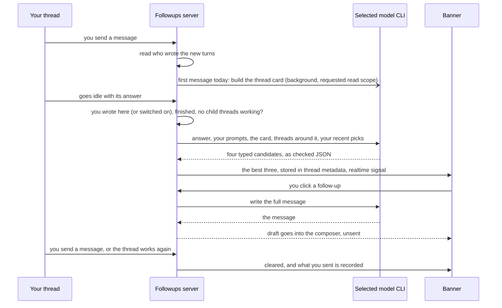

<div align="center">


# Followups

### Your next message, drafted when a thread finishes.

Follow-up prompts drawn from a thread's last answer, right above its message box.<br>
Pick one for a ready-to-send draft. Nothing is ever sent for you.


[Features](#features) · [Install](#install) · [How it works](#how-it-works) · [Cost and safety](#cost-and-safety) · [CLI](#cli) · [Settings](#settings) · [Development](#development) · [Design notes](docs/DESIGN.md)

<br>


</div>

<br>

> [!NOTE]
> The screenshots are real BB captures populated with fictional demo data.

## The problem

An agent finishes. Its answer ends with "Want me to add a test?", or mentions
a risk it didn't check. You read it, decide what comes next, and type it out.
Every time, in every thread.

**Followups reads the finished answer and puts three next steps above the
message box**, each with the reason it's worth doing. When the answer ends with
a question, the first one answers it. Click one and it becomes a full message
in your composer. You still decide, and you still press send.

|  | Without Followups | With Followups |
| --- | :---: | :---: |
| See the next steps an answer points to | ❌ | ✅ with a reason each |
| Answer the agent's questions | ❌ type it yourself | ✅ one tile |
| Turn a next step into a full message | ❌ type it yourself | ✅ one click |
| Know what each suggestion cost | — | ✅ time and tokens |
| Only where you write | — | ✅ agent-only threads stay quiet |
| Sends anything on your behalf | — | ❌ never |

## Features

<table>
<tr>
<td width="50%" valign="top">

### 💡 Three typed suggestions
When a thread finishes, a model drafts three follow-ups in your voice, each of
a kind (answer, continue, check, refocus, delegate, close) and with a short
reason under it. An answer that ends with questions or numbered options gets
one tile that settles them all first.

</td>
<td width="50%" valign="top">

### ✍️ A full draft in one click
Click a follow-up and it becomes a ready-to-send message in the composer. It
fills an empty composer, or goes below what you've typed. Slow? Cancel it.

</td>
</tr>
<tr>
<td valign="top">

### ⌨️ Keyboard friendly
With focus in the banner, the arrow keys move between tiles, 1–9 draft one,
and Esc returns to the composer. The banner starts collapsed; click its header
to show the follow-ups. That set stays expanded across thread switches and
plugin reloads until you collapse it. New suggestions start collapsed.

</td>
<td valign="top">

### 🎚️ Only threads you write in
A thread gets follow-ups once you have written in it. Threads only agents,
crons or plugins write in get none. The button in each thread's header turns
them on or off for that thread, whatever the rule says.

</td>
</tr>
<tr>
<td valign="top">

### 🧮 See what it cost
A footer shows how long each run took and its tokens. **Details** opens the
split (new input, cached, output, reasoning) and the model that did the work.

</td>
<td valign="top">

### ⏳ Waits until the work is done
Nothing is suggested while a thread, or any of its child threads, is still
working. Sending a message clears the banner.

</td>
</tr>
<tr>
<td valign="top">

### 🗂️ A card per thread
In the background, each thread you write in gets a short card: its task, its
project, which of your goals it moves, earlier decisions. Suggestions read it,
and so can other plugins ([docs/CARD.md](docs/CARD.md)).

</td>
<td valign="top">

### 📈 It learns what you pick
Your recent picks and what you actually sent go into the next suggestions.
`bb followups stats` shows how often a suggestion became your message.

</td>
</tr>
</table>

<div align="center">
<br><sub><b>One click, a full draft, and what both runs cost</b></sub>
</div>

## Install

```sh
bb plugin install git:https://github.com/MacHatter1/bb-plugin-followups --yes
```

Follow-ups appear the next time a thread you wrote in finishes. Suggestions,
drafts, and cards default to `gpt-6-luna` at `max` through `codex exec` on your
ChatGPT login. Set `model` to `claude-haiku-5-5` to use your Claude login.
An explicitly saved Claude model remains selected after an upgrade.

<details>
<summary><b>Install from a local clone</b></summary>

```sh
git clone https://github.com/MacHatter1/bb-plugin-followups
cd bb-plugin-followups
npm install && bb plugin build
bb plugin install path:$PWD --yes
```

</details>

**Requirements**

- bb **0.45+** (Plugin SDK 0.6.15+)
- The repository is private, so the installing machine needs GitHub
  credentials with access to it.
- The `codex` CLI on the bb server's `PATH`, signed in with ChatGPT. The native
  suppression flags target codex-cli 0.163.0. For Claude models, the signed-in
  `claude` CLI is required instead. The plugin removes inherited API-key
  overrides from Codex calls and preserves HOME and CODEX_HOME.
- For thread cards, optionally: the `ov` CLI (OpenViking memory), the
  tasks-hub `otask` script and the morning-brief output. A missing source is
  recorded as a gap on the card.

## Where to find it

| Where | What |
| --- | --- |
| **Above the message box** | The **Follow-ups** banner: numbered tiles with their reasons, **Cancel** while a draft is written, **✕** to dismiss, and the cost footer. |
| **Thread header** | The follow-ups switch for that thread. A slash over the icon means off. |
| **Settings → Installed plugins → Followups** | The plugin's four settings: model, effort, cards, card runs at once. |

## How it works



- **Only where you write.** Each thread's turn requests say who wrote them:
  you, an agent's `bb thread tell`, or a child's report. A thread you started
  in the app or wrote in gets follow-ups; one an agent, cron or script started
  with `bb thread spawn` and only agents talk to gets none. The header switch
  overrides this either way.
- **Drawn from the answer and the thread.** The model sees the answer (cut in
  the middle when it's long, so its closing offers and questions survive),
  your last three messages, the thread's first prompt, the time in Bangkok,
  the thread's card, its parent, children and neighbouring threads, and your
  recent picks. It returns four candidates with a kind; assistant-voice labels
  and duplicates are dropped and the banner shows three.
- **One model call.** Each suggestion and draft is one process in a private
  temporary directory, with output checked against the same strict schema.
  The model name selects Codex or Claude. At most four suggestion calls run
  at once. Codex requires successful completion and reads the final answer
  only from its output file.
- **Stale work stops.** Send a message, dismiss the banner, switch the thread
  off, or let it work again, and the call drafting for the old answer is
  killed at once. A late result is dropped.
- **Thread cards.** On your first message of the day in a thread, a background
  run builds its card. Suggestions never wait for it. See
  [docs/CARD.md](docs/CARD.md) for what goes in and how other plugins read it.

The full detail, including timings, edge cases and cleanup rules, is in
[docs/DESIGN.md](docs/DESIGN.md).

## Cost and safety

- ✋ **Never sends.** A follow-up only fills the composer. You press send.
- 📝 **Never overwrites what you typed.** A draft replaces an empty composer,
  or its own unedited draft. Anything else gets the draft added below.
- 🔒 **Prompt-only suggestions and drafts.** Claude disables tools with
  `--tools ""`. Codex disables shell execution, web search, apps, plugins,
  memory, delegation, images, and browser features, and uses a read-only
  sandbox. Code-mode `exec` remains available and is absent from JSONL, so
  this does not establish a zero-tool boundary. Both receive a no-tools
  instruction and the conversation as source material.
- 🗂️ **Cards request limited exploration.** Claude keeps its restricted
  readers and `ov find` allowlist. Codex uses a network-enabled workspace-write
  sandbox with a private working directory and no writable project added.
  Its project read scope, `ov find` restriction, step budget, and per-command
  timeout are instructions. Other host-readable files and remote APIs remain
  reachable. Both enforce the 240-second whole-call deadline by killing the
  process group. See the [enforcement table](docs/CARD.md#exploration-limits).
- 💸 **Spends tokens on purpose.** Every finished thread you write in gets one
  suggestion call, at most four at once, and a click one draft call. Cards run
  at most once a day per thread unless the suggestions flag one as stale, at
  most two at once. The footer shows each run's cost; `stats` sums the cards.
- 🧹 **Cleans up completed calls.** Each call removes its temporary files after
  the process closes. A plugin-host crash can leave a child or temporary files.
  No worker threads are spawned. `bb followups cleanup` deletes hidden workers
  earlier releases left.
- 🙅 **No agent tools.** Agents can't write follow-ups. The banner is yours.

## CLI

`bb followups <command>`. Every command takes `--json`.

```sh
bb followups show <thread-id>       # the stored follow-ups with their kinds, and what the run cost
bb followups off <thread-id>        # turn follow-ups off for one thread
bb followups card <thread-id>       # the thread's card
bb followups stats                  # how often a suggestion became your message
```

<details>
<summary><b>All commands</b></summary>

| Command | Does |
| --- | --- |
| `show <thread-id>` | The stored follow-ups with their kinds, and what the run cost. Says why a thread gets none. |
| `clear <thread-id>` | Clear them. |
| `on <thread-id>` / `off <thread-id>` | Turn follow-ups on or off for one thread, whoever writes in it. `on` drafts right away for a finished thread. |
| `model` | Show the model, effort, and provider route every call uses. |
| `model-clear` | Reset the model and effort to `gpt-6-luna` and `max`. |
| `regenerate <thread-id>` | Draft a thread's follow-ups again now, and print where the time went. Refuses a thread that gets none, is still running, or is waiting on child threads. If a call is already running, that one is stopped and this waits for its own run. |
| `draft <thread-id> <suggestion-id>` | Run the draft step for one follow-up, with the same timing breakdown. Not counted as your pick. |
| `card <thread-id> [--refresh]` | The thread's card and its last build. `--refresh` builds it now and waits. |
| `cards [--project <id>] [--day today\|YYYY-MM-DD]` | Thread cards, newest first. |
| `stats [--days <n>] [--project <id>]` | Banners, how many you answered, sent as drafted, edited or replaced with your own message, by kind; and what card runs cost. Default 7 days. |
| `cleanup [--dry-run]` | Delete the hidden worker threads earlier releases left behind. |

`regenerate`, `draft` and `card --refresh` each make a real model call.

</details>

**Agent tools:** none. The bundled [skill](skills/followups/SKILL.md) tells
agents the banner is yours, to inspect it with `bb followups show` only when
asked, how to read a thread's card, and to leave the settings to you.

## Settings

`bb plugin config followups`, or **Settings → Installed plugins → Followups**.

<details>
<summary><b>All settings</b></summary>

| Setting | Default | |
| --- | --- | --- |
| `model` | `gpt-6-luna` | `gpt-*` selects Codex. `claude-*`, `haiku`, `sonnet`, and `opus` select Claude. Unknown names produce an error without starting a call. |
| `effort` | `max` | Thinking effort for every call: `low`, `medium`, `high`, `xhigh` or `max`. |
| `card` | `true` | Build thread cards in the background and use them in suggestions. |
| `cardRuns` | `2` | How many cards may be built at once (1 to 3). |

Which threads get follow-ups is not a setting: threads you write in do, and
each thread's header switch overrides that.

</details>

<details>
<summary><b>Turning it off</b></summary>

```sh
bb followups off <thread-id>                    # off for one thread
bb plugin config followups set card false       # no thread cards
bb plugin disable followups                     # unload the plugin
bb plugin enable followups
```

`bb plugin remove followups` removes the plugin and its settings.

</details>

## Development

```sh
npm install
npm test                           # node:test on the SDK's fake plugin host, with fake `codex` and `claude` CLIs
npm run typecheck
bb plugin build                    # dist/server.js, dist/app.js, dist/app.css
bb plugin install path:$PWD --yes
bb plugin dev                      # rebuild and reload on every save
```

```
server.ts               events, gates, storage, RPC and the CLI
app.tsx                 the banner and the header switch
lib/model.ts            model choice, transports, process lifetime, output validation
lib/thread-context.ts   who wrote each turn, and what the calls see of a thread
lib/start-origin.ts     how a thread was started, from bb's dispatch hook
lib/suggest.ts          suggestion and draft prompts, and picking three
lib/learning.ts         what you did with each banner (SQLite)
lib/card*.ts            thread cards and their public contract
lib/banner-*.ts         the banner's per-thread memory and collapse state
components/             Button, BB's Icon, and Glyph (Hugeicons drawn directly)
skills/                 the bundled agent skill
tests/                  node:test suites and fake Codex and Claude CLIs
docs/                   design notes, the card contract, logo
```

**Tests** run the whole server on the SDK's fake plugin host with Node's
built-in test runner (Node 22.18+, which runs the `.ts` sources directly; no
extra packages). `tests/fake-codex/codex` and `tests/fake-claude/claude` go first
on `PATH`. They log each call and answer from fixtures. Codex fixtures cover
chunked JSONL, completion, strict schemas, final files, errors, and cancellation
of descendants. Both providers drive suggestions, drafts, and cards. Tests that start it need an executable temporary directory
(`TMPDIR=… npm test` where `/tmp` is `noexec`).
[docs/DESIGN.md](docs/DESIGN.md#tests) lists what each file covers.

`PLUGIN_OVERVIEW.md` is the store listing. Keep it in step with
`bb.description` in `package.json`.

## Licence

[MIT](LICENSE)
